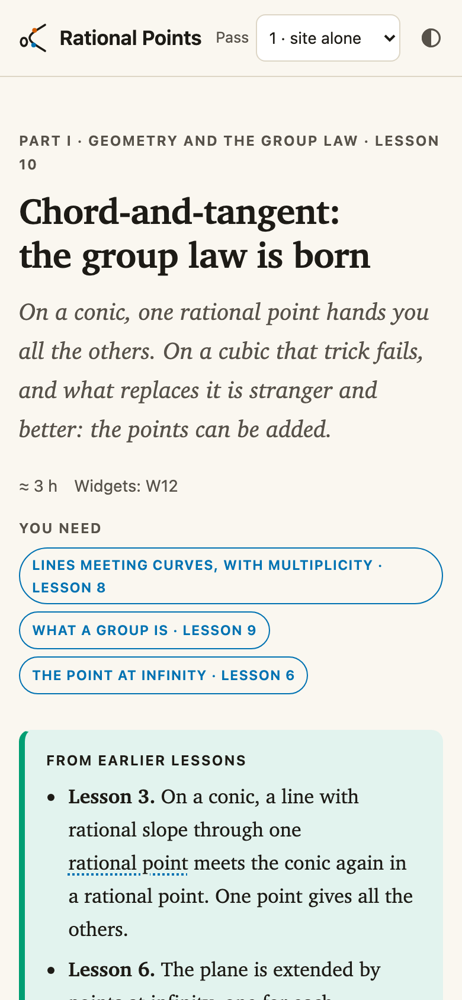
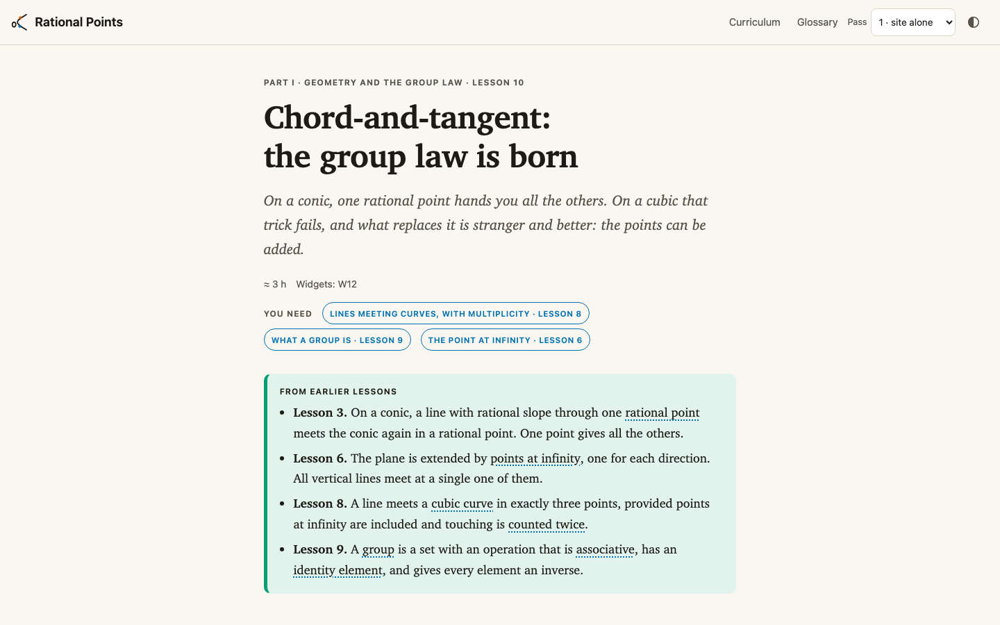
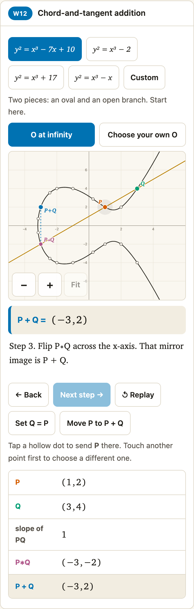
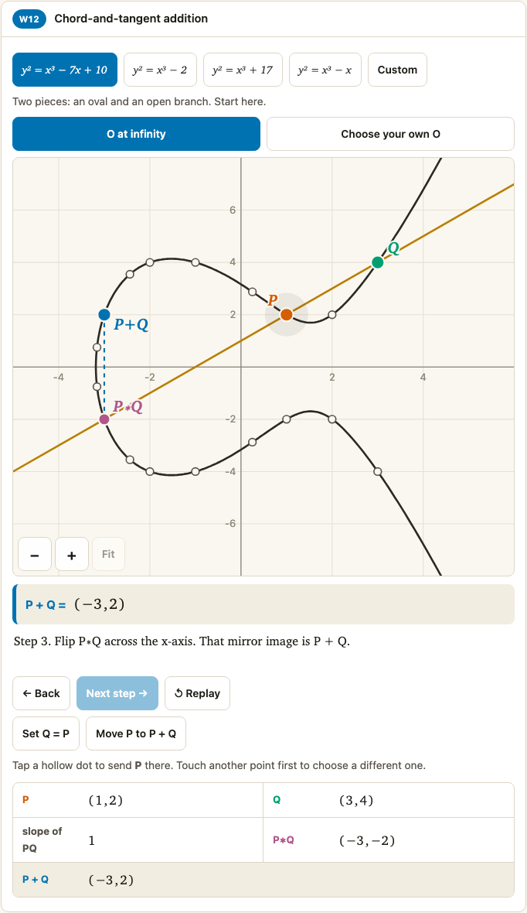
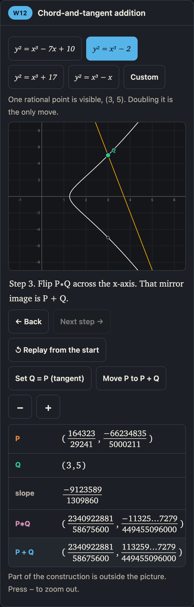

# Phase 0 report

Date: 2026-11-24. Live site: https://nkaditya1729.github.io/rational-points/ ·
Sample lesson: https://nkaditya1729.github.io/rational-points/lessons/10-chord-and-tangent/ ·
Repo: https://github.com/NKAditya1729/rational-points (public)

## What exists

| Piece | State |
|---|---|
| Astro + MDX + Preact + KaTeX scaffold, design system (Okabe–Ito, light/dark, mobile-first, print rules) | Built |
| Maths engine in `src/lib/math` (rationals, group law over Q and F_p, heights, Nagell–Lutz, 2-descent, Pollard p−1, ECM, level-11 η-product) | Built, 32 tests pass |
| Deploy pipeline (tests → build → GitHub Pages) | Green; live URL returns 200 |
| Lesson 10 + widget W12 | Built as a **style prototype** |
| Home page with the full 57-entry curriculum (lessons 0–56) | Built; only Lesson 10 is linked |
| Lessons 0–9, 11–56, widgets other than W12, exercises, glossary, search, dependency graph, pass selector | Not built (later phases) |

## Test evidence

- `npm test`: 32 of 32 pass. Every value named in the master prompt is asserted: Z/2×Z/2 and rank 0 for
  y² = x³ − x; Z/7 from (3, 8) on y² = x³ − 43x + 166; Z/6 on y² = x³ + 1; 2(3, 5) = (129/100, −383/1000);
  the 16 integer points of y² = x³ + 17 up to x = 5234; (1, 2) + (3, 4) = (−3, 2); Hasse for all odd primes
  below 1000 on five curves; 6 affine points of x³ + y³ = 1 over F₇; ECM factors 1715761513; a_p(11a) equals
  the η-product coefficient for every prime p ≤ 50 except 11.
- `npm run e2e`: 10 of 10 pass (5 tests × 390×844 and 1440×900): base-path links, no sideways scroll, no
  failed requests or script errors, exact widget results, tangent, vertical line, singular curve, huge
  numbers, keyboard movement, drag-and-snap, saved progress.
- Lighthouse on the live lesson page (mobile emulation): performance 100, accessibility 100, best practices 100.
- Live check: the deployed widget computes 2(1, 2) = (−1, −4) with no failed requests.

## Condition 1 — the PDFs are not in the repository

Output captured immediately before the first commit and push:

```
== git check-ignore -v ==
.gitignore:1:docs/private/	docs/private/RPEC.pdf
.gitignore:1:docs/private/	docs/private/ET.pdf
== tracked PDFs (must be empty) ==
== tracked files under docs/private (must be empty) ==
```

`git status --short` at that moment listed 50 added files, none under `docs/private/` and none ending in
`.pdf`. After the commit, `git ls-files | grep -ci pdf` printed `0`. `.gitignore` also carries a blanket
`*.pdf` rule as a second guard.

## Condition 2 — page mapping

Measured by reading the running header of every PDF page; full table in `docs/page-map.md`.

- Front matter is mapped separately: roman page r is PDF page r + 1 (Preface v = PDF 6; Introduction
  xv–xxii = PDF 16–23).
- **The main-text offset is not a constant +23.** It is +23 only for Chapters 1–2, then +22 (Ch. 3),
  +21 (Ch. 4–5), +20 (Ch. 6 and Appendix A), +19 (Appendix B), falling to +17 in the index. The PDF omits
  blank pages. Using +23 throughout would have put every Chapter 3–6 lookup on the wrong page.
- Elliptic Tales (now in `docs/private/ET.pdf`): printed + 22 throughout, checked at every chapter start.
  Chapter start pages in the research report match the PDF.
- Lesson 10's reading card was checked against both PDFs: S–T pp. 8–13 (§1.2 up to where associativity is
  raised, top of p. 14); ET pp. 95–99 and 116–119.

## Condition 3 — the prototype

Screenshots (in `docs/screenshots/`):

| | Mobile 390 px | Desktop 1440 px |
|---|---|---|
| Top of lesson |  |  |
| Widget W12 |  |  |

Dark theme, after doubling twice on y² = x³ − 2: 

### What I would change before this becomes the Phase 1 template

Ordered by how much each affects learning.

1. **Self-checks are not instantly checkable.** The research report asks for an answer box that the engine
   verifies. The prototype has only hint ladders. Build an `AnswerCheck` component (type a point, get
   right/wrong plus the first wrong step) and use it in every lesson.
2. **No glossary.** "Non-singular", "subgroup" and "implicit differentiation" appear with only a lesson
   reference. The rule is no undefined term, so the glossary with hover/tap cards must exist before
   Lesson 0 is written.
3. **The lesson leans on lessons that do not exist yet** (6, 8, 9, 12). That is unavoidable for a
   mid-course sample, but the template needs a short "from earlier lessons" recap box, and prerequisite
   chips must become links.
4. **On a phone the answer is far from the picture.** Four rows of buttons sit between the plot and the
   result table, so P + Q is about a screen below the point you are dragging. Put a one-line result strip
   directly under the plot and fold the secondary controls away.
5. **The animation is only a fade.** For "story-telling" the line should draw itself from P through Q,
   and the third point should visibly travel across the axis to its mirror image. Step mode stays for
   reduced motion.
6. **"Predict, then play" is not enforced.** The tries are listed, but nothing asks for a guess first.
   Add a predict-then-reveal prompt to the widget frame.
7. **Points can leave the picture.** After "Move P to P + Q" the point P is often off-screen and its
   handle disappears. Add automatic fit-to-construction, with the manual zoom kept.
8. **Hollow dots can only be reached by dragging.** Tapping one should move the active point there.
9. **The widget shows only O at infinity.** The book's §1.2 pictures use a freely chosen O on a general
   cubic. The text explains the link, but a small second view (planned as W13) should show it.
10. **Reading card position.** It currently comes last, after the self-check. The research report's
    template puts it before. Your call; see the question below.
11. **No pass selector.** Pass 1–4 behaviour (hide reading cards in pass 1, hide solutions in pass 4) is
    not built; only "mark as read" is stored.
12. **Lesson length and time estimate are untested.** "≈ 3 h" is my guess. Your first read-through
    should calibrate it.

Smaller items: the config uses a deprecated way of passing the maths plugins to Astro 7 (works, prints a
warning); the print stylesheet is written but not checked on paper.

## After review (2026-11-24, second round)

Applied at Aditya's request and redeployed. Phase 1 has **not** been started.

| Item | What changed |
|---|---|
| 1 Answer checking | `AnswerCheck` island: type a point (or tick "the answer is O"); the engine checks it and names the step to revisit (not on the curve / forgot to reflect / sign of y / wrong slope). Four checkers in Lesson 10. |
| 2 Glossary | 14 entries in `src/content/glossary/`, a `/glossary/` page, and `<Term>` tap cards (native popover) used through Lesson 10. |
| 3 Recap and prerequisites | "From earlier lessons" box at the top; prerequisite chips are links (to the lesson once written, to its line in the curriculum until then). |
| 4 Result near the picture | A result strip sits directly under the plot; zoom controls moved onto the plot; one row of buttons removed. |
| 5 Motion | The line draws itself, a marker runs to the third point, and the point is carried across the axis. Reduced-motion users step by hand. |
| 6 Predict, then play | `Predict` component: the explanation appears only after a choice. Two prompts before W12. |
| 7 Auto-fit | The picture grows to contain the whole construction and holds still while a finger is down. |
| 8 Tap targets | Tapping a hollow dot sends the active point there. |
| 11 Pass selector | In the header, saved on the device. Pass 1 folds the reading card, pass 2 opens it, pass 3 shows the exercise placeholder, pass 4 hides hints and written answers. |
| a Choose your own O | Toggle on W12 (default stays O at infinity). Matches the general-O pictures of S–T pp. 8–13. Verified: with O = (2, 2), (1, 2) + (3, 4) = (41/25, 214/125); Q on O gives P; a sample of associativity holds. |
| b Reading card | Now placed before the self-check. |
| c Research report | The three links to sites hosting copies of the book are replaced by a "link removed" note. The repository history was then rewritten to a single root commit (2026-11-24), so the links appear in no commit on `main`. |
| d Lesson 12 wording | Both places now say: brought to y² = x³ + ax² + bx + c, then a shift in x removes the x² term to give y² = x³ + ax + b. |
| e Label | "Style prototype" removed from the lesson header. |
| f LMFDB | Recorded as an acceptance criterion in `CLAUDE.md`; log started in `docs/lmfdb-checks.md` with the one rank/torsion claim currently on the site (y² = x³ − x, LMFDB 32.a3: rank 0, Z/2 × Z/2, agrees). |

### Bugs found during this round

- **Hint ladders were broken in the first Phase 0 deployment.** Hints and answers were printed inline under
  each question instead of being folded, so the answers were visible. Cause: named slots do not pass from
  MDX into Astro components. Fixed with separate `Hint` and `Answer` components, and a browser test now
  checks that they start folded.
- Replay could stall at step 0 if pressed while a step was still animating (a stale animation frame
  overwrote the reset). Fixed with a token on animation frames.
- A long prerequisite chip made the page 7 px too wide on a phone. Fixed.

### Test evidence after this round

40 of 40 engine and construction tests; 14 of 14 browser tests (7 tests × mobile and desktop).

New screenshots: `lesson10-mobile-own-O.png`, `lesson10-desktop-own-O.png`,
`lesson10-mobile-mid-animation.png`, `lesson10-mobile-answer-check.png`.

### Still open from the first list

- 9 is done (item a). 10 is done (item b). 12 (time estimate) waits for your read-through.
- Print stylesheet unchecked on paper; Astro Markdown-plugin deprecation warning remains.

## Differences from the plan

- Engine modules `divpoly` and `weierstrassP` are deferred to the phases that use them (2 and 6).
- "Cross-check curve data against LMFDB" was **not** done. a_p(11a) was checked against the η-product
  instead, and torsion against the values in the research report. The rank of y² = x³ + 17 is asserted
  nowhere.
- The 2-descent is verified on four curves with known answers. Its "undecided" outcome has not been
  exercised on a genuinely hard curve.
- Pagefind search and the dependency-graph page are listed under UX in the master prompt and are not
  in Phase 0.
- Astro is version 7; its preview command and Markdown defaults changed, which is recorded in `CLAUDE.md`.

## Decisions I need from you

1. **`docs/research-report.md` is now public.** It is your own report, as the master prompt asked. Its
   source list includes links to three sites that host copies of the book. Keep it public as is, strip
   those links, or move the report to `docs/private/`?
2. **Reading card before or after the self-check?**
3. **Which of the twelve changes above go in before Phase 1 starts?** My recommendation: 1–8 and 11.
